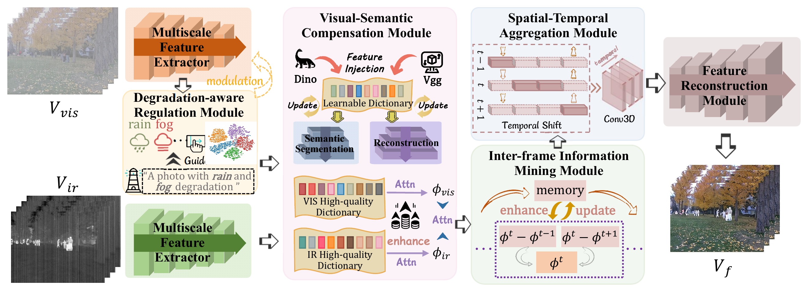

# TemRF

**TemRF: Temporal Modeling for Robust Multi-modal Video Fusion**

TemRF is a multi-modal video fusion framework designed to handle complex degradations while preserving useful visual details, semantic information, and temporal consistency across frames.

## Network Architecture

## Results

## Code Availability

This repository is reserved for the official implementation of TemRF. The source code will be made publicly available upon acceptance of the paper.
